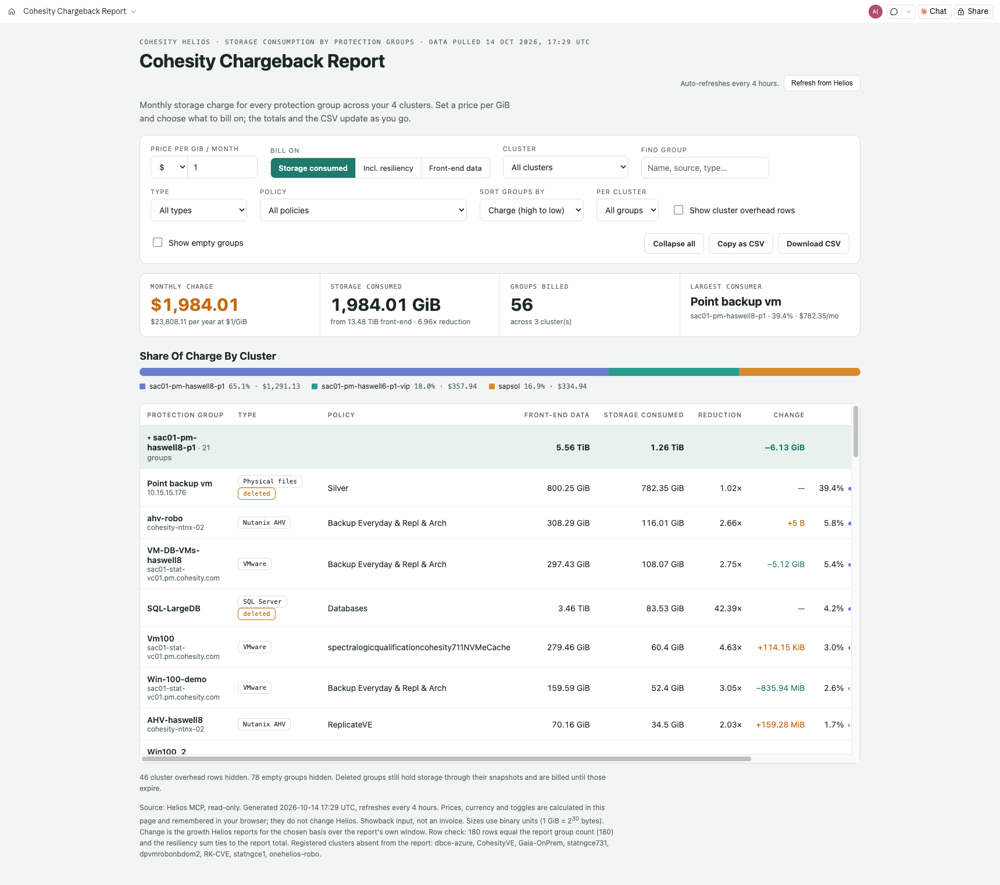

# Cohesity Chargeback Report

**Authors:**

- Akshay Kumar, Dir, Solutions Architecture ([akshay.kumar2@cohesity.com](mailto:akshay.kumar2@cohesity.com))
- Dave Stemerdink, Principal Sales Engineer ([david.stemerdink@cohesity.com](mailto:david.stemerdink@cohesity.com))

A Claude skill, also available as a Microsoft Copilot Studio agent, that turns the Helios **Storage Consumption by Protection Groups** report into an interactive chargeback (showback) page: the monthly storage charge for every protection group across your clusters. It is published as a live, private Claude Artifact and refreshes every 4 hours.

You set a price per GiB and choose what to bill on; the totals, the share-by-cluster bar and the CSV update instantly in the page.

- Claude skill: [`claude/Cohesity-Chargeback-Report/SKILL.md`](claude/Cohesity-Chargeback-Report/SKILL.md) (the full page template is embedded in it)
- Output: one claude.ai **Artifact** titled `Cohesity Chargeback Report` (no static HTML file), with Copy as CSV and, where available, Download CSV
- Refresh: scheduled task `cohesity-chargeback-report-refresh`, cron `0 */4 * * *`. A refresh costs two Helios calls because the report does the aggregation.
- Data source: the **Helios MCP server** (`helios-mcp` connector), read-only.

## Two Versions

| | Claude skill | Microsoft Copilot Studio agent |
|---|---|---|
| Folder | [`claude/`](claude/Cohesity-Chargeback-Report/SKILL.md) | [`copilot-studio/`](copilot-studio/README.md) |
| Output | Live, private Claude Artifact, refreshed every 4 hours | Answers in chat, with tables, on demand |
| Helios access | `helios-mcp` connector, read-only | Helios MCP server added as a tool, read-only |
| Setup | Install the skill in Claude (see Install below) | Paste `instructions.md`, upload `knowledge/` files, add the Helios MCP tool |
| Sample output | [Screenshot below](#screenshots-claude-version) | [copilot-studio/SAMPLE-OUTPUT.md](copilot-studio/SAMPLE-OUTPUT.md) |
| Model | Claude | GPT-5 Reasoning |

The sections below describe the Claude skill unless a heading says Copilot Studio.

## What you get

| Area | What it shows |
|---|---|
| Header | "Cohesity Helios · Storage consumption by protection groups · Data pulled <date and time, UTC>", title and a summary line naming the clusters |
| Controls | Price per GiB / month with currency (`$ € £ ₹ ¥`); **Bill on**: Storage consumed, Incl. resiliency, Front-end data; Cluster; Find group (name, source, type, policy); Show cluster overhead rows; Show empty groups; Copy as CSV. Choices are remembered in the viewer's browser. |
| Extra filters | Environment type, policy and sort dropdowns, a per-cluster top-N selector and a collapse/expand-all button; cluster header rows collapse on click. |
| KPI strip | **Monthly charge** (with the yearly figure), **Storage consumed** or Front-end data (with front-end size and data reduction), **Groups billed** (with cluster count), **Largest consumer** (cluster, share of charge, charge per month) |
| Share of charge by cluster | One stacked bar and a legend with each cluster's share and charge |
| Grouped table | A header row per cluster with totals, then one row per protection group: name with its source names, type chip, policy, front-end data, storage consumed, reduction, change, share with a mini bar, charge per month |

## Where every number comes from

One Helios MCP call: `reporting-get-report-preview` for the report `storage-consumption-group`, component `400` (one row per protection group and target) plus the glance component `401` for a tie-out.

| Column or setting | Helios field | Notes |
|---|---|---|
| Front-end data | `dataIngestedRetainedBytes` | Logical retained data before data reduction |
| Storage consumed (default basis) | `scRetainedBytes` | Physical storage used after dedupe and compression |
| Incl. resiliency (third basis, an addition to the original design) | `scResiliencyBytes` | Adds the extra copies the cluster keeps for resiliency |
| Reduction | `dataReduction` | Helios's own ratio |
| Change | `scRetainedBytesGrowth`, `scResiliencyBytesGrowth`, `dataIngestedRetainedBytesGrowth` | Growth Helios reports for the chosen basis over the report's own window |
| Type chip | `environment` | Mapped to a readable label (for example `kView` is "View / SmartFiles") |
| Cluster | `system` | |
| Cluster overhead rows | rows with an empty `groupName` | Storage Helios cannot attribute to a protection group; hidden by default |
| "deleted" chip | `groupName` starting `_DELETED_` | The group is gone but its snapshots still hold storage |

Sizes use binary units (1 GiB = 2^30 bytes). `Charge = billed volume in GiB x price`.

## What it is not

- It is **showback input, not an invoice**. The price is whatever you type; the skill never assumes a price list or converts currencies.
- Overhead storage is never silently added to a team's charge: it appears only when you tick "Show cluster overhead rows", and then it is included in the totals so they match the cluster.
- No other Helios MCP tool returns storage per protection group; per-run bytes written are not a substitute. If your role cannot run reports, the skill says so and stops.

## Requirements

- Claude desktop app (Cowork) with the **Helios MCP** connector (Controlled Availability: ask your Cohesity account team to enable it) and a Helios role that can run reports.
- Artifacts, the artifact `downloads` capability (optional) and scheduled tasks. Scheduled tasks run only while the Claude app is open.

## Install

1. Zip the folder `claude/Cohesity-Chargeback-Report` so `SKILL.md` is inside it.
2. Add it as a custom skill in Claude (Settings, Skills, upload) or copy it into your skills directory. The scheduled refresh runs the skill by name, so it must be installed for the 4-hour refresh to work.
3. Confirm the Helios MCP connector is connected.

## Use

- "Build the Cohesity Chargeback Report"
- "Who is the largest backup storage consumer and what does it cost at 0.05 per GiB?" (the page recalculates; ask Claude to set a default only if you want one baked in)
- "Refresh the chargeback page"

The first run publishes the artifact and creates the 4-hour task. Later runs find the artifact by title and republish to the same URL. Your price, currency, basis and toggles survive a refresh because they live in your browser. The page is private until you share it from its Share menu.

## Notes from live testing

Validated on a lab Helios tenant on 2026-10-13: 179 report rows across 4 clusters (the other 8 registered clusters are not connected), 46 rows of cluster overhead, about 13.5 TiB of front-end data stored in about 1.9 TiB (roughly 7x reduction), groups on deleted protection groups still holding storage, and no duplicate group keys. The row count matched the report's group count and the summed resiliency storage matched the report total exactly. A browser-level smoke test of the filled page checked the KPIs, the basis switch, the price input, the cluster filter and the overhead toggle with no script errors.

## Manual refresh

The page header has a **Refresh from Helios** button. A published page cannot call Helios on its own, so the button copies `Run the Cohesity-Chargeback-Report skill to refresh this report from live Helios data`; paste it into Claude to pull live data and republish the same artifact, then reopen or refresh the tab. The scheduled task (every 4 hours) and this command are the two refresh paths.

## If the artifact was deleted

If the stored artifact URL no longer exists, the skill republishes the page as a new artifact and says so in its reply, so a deleted page never blocks a refresh. Update the scheduled task prompt with the new link.

## When Helios is unreachable

If `helios-mcp` is down or its token has expired, a scheduled refresh does not clear the page. It keeps the last successful data and adds a red banner, "Unable to connect to Helios. Showing the last successful data.", under the header. The next successful refresh removes the banner.

## Known limits

- The page recalculates from data embedded at generation time; it does not query Helios live. Use the 4-hour refresh or ask for a new run.
- Change uses Helios's own growth window, which this skill does not control.
- Hostnames appear as source names under each group; share the artifact accordingly.
- The page lists the clusters present in the report; clusters registered but not in the report are named in the footnote.

## Screenshots (Claude Version)



_Captured from the published artifact; cluster and group names are lab data._

## Microsoft Copilot Studio Version

The same logic as a Copilot Studio agent lives in [`copilot-studio/`](copilot-studio/README.md): `instructions.md` (agent instructions), `knowledge/` (two files to upload as Knowledge), `starters.md` (example prompts) and step-by-step setup. It answers in chat and does not publish a page, schedule itself, or offer a cluster picker or CSV button. Add your Helios MCP server as a tool and enable only the read-only tools.

## Repository layout

```
Cohesity-Chargeback-Report/
  README.md
  claude/
    Cohesity-Chargeback-Report/SKILL.md      Claude skill (install this folder in Claude)
  copilot-studio/
    README.md          setup steps
    instructions.md    agent instructions
    knowledge/         files to upload as Knowledge
    starters.md        example prompts
    SAMPLE-OUTPUT.md   sample answer with screenshot
  docs/
    screenshots/chargeback-report.png
    screenshots/chargeback-report-copilot.png
```
