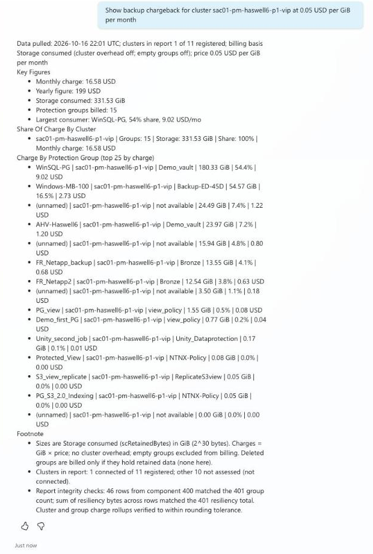

# Sample Output: Cohesity Chargeback Agent

Prompt: `Show backup chargeback for cluster sac01-pm-haswell6-p1-vip at 0.05 USD per GiB per month`

Model: GPT-5 Reasoning. Lab data. Captured in the Copilot Studio test pane in Light mode.

## Notes

| Topic | Note |
|---|---|
| Format | The answer is chat text with lists and tables. The Claude skill gives a live page. See `../docs/screenshots/chargeback-report.png`. |
| Accuracy | Check the group rows against the cluster total before you share the numbers. In testing, GPT-5 Chat returned totals that did not reconcile, so this agent uses GPT-5 Reasoning. |
| Showback only | The price is the one you give. The output is not an invoice. |
| Scope | Name one cluster for the fastest answer. |
| Your data | Cluster and group names in the image are lab data. Your answers will differ. |
